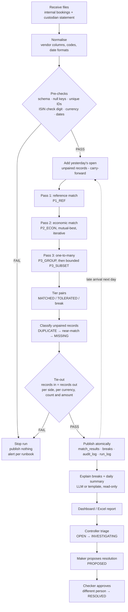

# Daily reconciliation process

| Stage | Owner | Output | Code |
|---|---|---|---|
| Normalise | Engine | clean external frame | `recon/normalise.py` |
| Pre-checks / tie-out | Engine (control) | `controls.csv` | `recon/controls.py` |
| Matching passes | Engine | `match_results.parquet` | `recon/sql/pass*.sql` |
| Classification | Engine | `breaks.parquet` | `recon/sql/classify_orphans.sql` |
| Audit | Engine | `audit_log.parquet`, `run_log.json` | `recon/engine.py` |
| Explanation | Explainer (read-only) | `breaks_explained.parquet`, `daily_summary.md` | `recon/explain.py` |
| Workflow | Controllers (maker + checker) | `break_register.parquet` | `recon/workflow.py` |
| Rule change | Change manager | parity report + release note | `recon/parity.py` |
